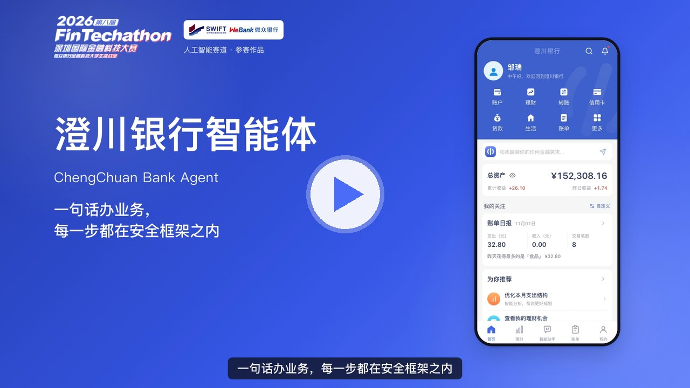

<div align="center">

# 澄川银行智能体 · ChengChuan Bank Agent

     

### 一句话办业务，每一步都在安全框架之内

可以直接运行的中文手机银行模拟器，内置一个能办业务的银行 AI 智能体。


[**演示视频**](#演示视频) &nbsp;·&nbsp; [**五分钟上手**](#五分钟上手) &nbsp;·&nbsp; [**演示指南**](docs/DEMO_GUIDE.md) &nbsp;·&nbsp; [**部署说明**](docs/DEPLOYMENT.md)

<sub>2026 深圳国际金融科技大赛 · 人工智能赛道参赛作品 · 团队：磐石金策（邹思瑞、万锦奇）</sub>

</div>

客户用一句话发起转账、分析账单、配置理财、管理卡片和订阅，或者让它把几件事串成一个按期执行的计划。**模型负责听懂和规划，服务端规则负责把关，最后由客户在 App 里确认。** 权限级别由服务端按金额和操作类型判定，模型改不了；聊天里永远不能直接动钱。

> 资金、交易、人脸和短信验证都是模拟的，不连接任何真实银行。两个公开演示账户的流水来自团队成员本人的对账单，个人姓名已替换为化名，详见 [演示数据](docs/DATA.md)。基金净值和业绩来自东方财富公开数据。

## 演示视频

<div align="center">

<a href="docs/media/demo.mp4"></a>

<sub>4 分 26 秒，依次介绍六大场景、飞书和微信渠道、记忆与安全防护，画面均为真实运行截图。点击封面在 GitHub 中播放（720p，约 10MB）。</sub>

</div>

## 界面一览

<table>
<tr>
<td width="50%"></td>
<td width="50%"></td>
</tr>
<tr>
<td align="center"><b>账单分析</b>：月报和分类占比由服务端按流水计算，每条回答标明数据来源</td>
<td align="center"><b>智能转账 · 权限分级</b>：确认前钱不动，大额需要加强验证</td>
</tr>
<tr>
<td></td>
<td></td>
</tr>
<tr>
<td align="center"><b>理财操作</b>：接入真实基金数据，超出测评等级的产品会被拦下</td>
<td align="center"><b>跨场景联动</b>：一句话拆成带依赖的计划，可中断或转人工</td>
</tr>
<tr>
<td></td>
<td></td>
</tr>
<tr>
<td align="center"><b>飞书、微信</b>：聊天里查账单、提议转账，确认只能回 App</td>
<td align="center"><b>安全防护</b>：注入防御、幻觉纠正、决策链路可追溯</td>
</tr>
</table>

## 五分钟上手

需要 Node.js 24 或更新版本。

```sh
npm ci
npm run dev        # 打开 http://127.0.0.1:5173
```

不配置任何密钥，银行的全部页面都能用。要用智能助手，把 `.env.example` 复制为 `.env`，填写 `CHAT_API_KEY`（OpenAI 兼容、支持函数调用的模型，示例为 DeepSeek），然后重启。

登录页已预填演示账户：

| 用户 | 手机号 | 登录密码 | 支付密码 |
| --- | --- | --- | --- |
| 邹瑞 | 18662995523 | Bank123456 | 123456 |
| 万奇 | 15040147842 | Bank123456 | 123456 |

点底部导航正中的「智能助手」，同意三份协议后即可对话。各场景的试用步骤见 [演示指南](docs/DEMO_GUIDE.md)。

其他命令：

```sh
npm test                    # 426 项自动化测试，不需要密钥和网络模型
npm run build && npm start  # 生产模式，http://127.0.0.1:3000
```

服务器部署见 [部署说明](docs/DEPLOYMENT.md)。

## 赛题六大场景

| 场景 | 能做什么 | 试一句 |
| --- | --- | --- |
| 智能转账 | 按人名、手机号、卡号识别收款人，先生成转账草稿，在可信页面核对后授权；定时转账、AA 收款 | 帮我给万奇转200元，备注聚餐 |
| 账单分析 | 日报、周报、月报、年报；按分类、商户、平台、时间统计；异常交易；隐形消费 | 2026年10月我的钱都花在哪了？ |
| 理财操作 | 99 只公募基金的真实净值和业绩；风险测评；按收支给出配置方案；产品对比；模拟申购赎回 | 我有两万元闲钱，一年内可能要用，帮我看看怎么配置 |
| 卡片管理 | 虚拟卡、冻结、限额调整、挂失 | 帮我申请一张虚拟卡，额度500元 |
| 订阅代扣 | 列出按月扣费的订阅，到期前提醒，帮你取消 | 我现在有哪些订阅在扣费？ |
| 跨场景联动 | 一句话拆成带依赖关系的计划，授权一次后按期执行，执行前复核，可中断或转人工 | 下周五是我妈生日，帮我锁定800元预算，当天订鲜花和蛋糕各400元，提前一天提醒我确认 |

另外，飞书和微信里也能查账单、提议转账，但确认只能回到 App 完成。账单日报、周报、月报可以定时推送。

## 安全设计

| 级别 | 适用操作 | 客户需要做什么 |
| --- | --- | --- |
| 可直接办理 | 查询、账单报告、产品对比、消费统计 | 无需确认 |
| 需授权确认 | 当日累计一千元以内的转账和缴费、AA、虚拟卡、冻结、取消订阅、查看订阅明细 | 在 App 内输入支付密码 |
| 需加强验证 | 超过一千元、理财申购、贷款提款、卡片挂失、修改密码、调高限额 | 模拟人脸 + 模拟短信验证码 + 支付密码 |

- **权限在服务端判定**：`server/agent/policy.mjs` 按操作和当日累计金额分级，模型只能提议。
- **直接注入**：识别“忽略之前的指令”一类话术，拒绝并记入审计，连续触发锁定助手 30 分钟。
- **间接注入**：转账附言等第三方文字含有指令时，发给模型前替换为“[第三方内容已隐藏]”。
- **幻觉防护**：模型声称办成了但没有回单时，服务端要求它纠正，仍不对就替换回复。
- **可追溯、可停止**：每轮工具调用写入决策链路，客户可以一键停止助手并撤销所有未执行的授权。

## 功能状态

| 功能 | 状态 |
| --- | --- |
| 三级权限、确认与加强验证、注入防御、幻觉防护、审计、沙箱分析 | 开启 |
| 个性化记忆（称呼、偏好，可查看、修改、删除） | 开启 |
| 语音输入、飞书、微信、邮箱验证码 | 配置对应密钥后开启 |
| 记忆 v2、行为模型、诈骗风险评分、年龄保护 | 观察模式：只记录，不影响结果 |
| 自适应认证、委托审批、动态策略、问候个性化 | 关闭（`server/puma/policy.json`） |

## 架构

```
手机端页面（React 19 + Vite 7）           飞书 / 微信
  银行页面 · 智能助手 · 可信核对页              │
            │ HTTP                              │
            ▼                                   ▼
Express 5 服务（server/app.mjs，只监听 127.0.0.1）
  ├─ 银行业务：账户、交易、理财、卡片、订阅、缴费   server/services.mjs、server/wealth.mjs
  ├─ 智能体：意图、工具循环、权限分级、注入与幻觉防护  server/agent/
  ├─ 风控与验证：转账草稿、加强验证、审计            server/risk/、server/verify.mjs
  └─ SQLite（node:sqlite）                         data/bank.sqlite
外部：OpenAI 兼容的聊天模型 · 百炼语音识别（可选）· 东方财富基金数据
```

## 测试

`npm test` 运行 426 项测试，覆盖六大场景、三级权限、注入防御、幻觉防护、记忆、渠道和风控。测试使用脚本化的假模型，所以证明的是服务端在任何模型输出下都守得住边界，而不是模型本身的理解能力。场景与测试的对应关系、本次运行结果和已知缺口见 [测试说明](docs/TESTING.md)。

## 文档

- [演示指南](docs/DEMO_GUIDE.md)：评委按场景试用的步骤和提示词
- [部署说明](docs/DEPLOYMENT.md)：本地运行、生产模式、单机部署、环境变量
- [测试说明](docs/TESTING.md)：运行方法、场景对应、测试报告
- [智能体设计](docs/AGENT.md)：开通、权限、确认、安全、记忆、语音、渠道
- [演示数据与账单口径](docs/DATA.md)：数据来源与处理、统计规则、业务边界
- [API 说明](docs/API.md)：接口、OpenAPI、外部程序接入
- 专题：[人脸核身](docs/FACE.md)、[短信](docs/SMS.md)、[本地验证流程](docs/LOCAL_VERIFY.md)、[金融 Skills](docs/FINANCIAL_SKILLS.md)、[记忆架构](docs/MEMORY_ARCHITECTURE.md)、[风控](docs/risk-mvp/OPERATIONS.md)

## 目录

```
src/        前端页面与智能助手界面
server/     服务端：银行业务、智能体、风控、渠道、种子数据
tests/      自动化测试（node:test）
scripts/    测试运行器、演示与检查脚本、种子数据生成
docs/       文档；docs/images/ 截图，docs/media/ 演示视频
deploy/     部署脚本（本团队服务器的自动部署流水线）与通用模板 deploy/examples/
examples/   外部程序调用示例
```

## 许可

本作品不是开源软件。知识产权归参赛选手所有，主办方的使用权见 [LICENSE](LICENSE)。第三方组件按其各自许可证，见 [THIRD_PARTY_NOTICES.md](THIRD_PARTY_NOTICES.md)。
