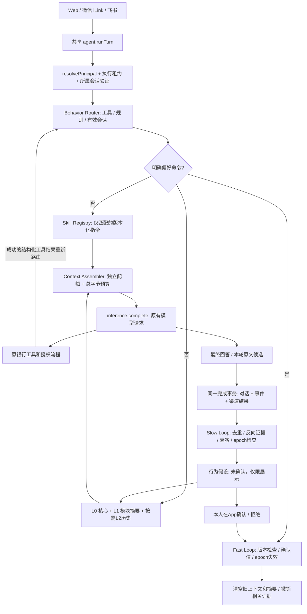

# 金融 Agent 模块化记忆架构

本文描述本次实际代码实现。运行环境为 Node.js 24、现有 Express 服务和 SQLite；没有新增运行时依赖、向量库或外部服务。旧版介绍见 `PERSONALIZATION_TECH_REPORT.md`，本文件取代其中关于检索结构的说明。

## 1. 原系统与改造依据

原调用链是 Web `/agent/chat`、微信 iLink 收件处理、飞书收件处理 → `agent.runTurn` → 已验证 principal → 服务端短期历史与 `memory.relevant` → `inference.complete` → 工具循环 → 保存候选、对话和审计。

原系统已经具备 `agent_memory` 当前值、`memory_candidates` 待确认项、`agent_sessions.history`、`memory_changes`、`memory_epochs`、字段版本和删除墓碑。候选必须引用当前用户原文，不能直接生效。推理入口负责配额、并发、幂等、超时和 usage 审计。这些机制继续使用。

主要问题是：原检索每轮读取该用户最新 200 条有效记忆，再做关键词排序；缺少领域与意图；已确认画像在所有任务中获得固定加分；专业知识与个人偏好没有独立加载机制；重复行为没有可追溯的假设状态。近期无关记录可能挤掉较早的重要偏好，单次提问也不能用来推断长期风险属性。

本次采用增量模块化改造：保留原身份、权限、银行工具、渠道入口、推理循环和当前值唯一约束，只替换上下文选择层，增加持久化行为证据及确定性整合。

## 2. 最终架构与真实数据流



图中的工具回路复用原本最多 6 轮模型调用，不为路由或整合另开模型请求。系统指令、实时账户上下文、Skill 指令、偏好数据和短期历史保持明确角色边界。工具执行成功后，可信工具名称可改进下一轮的模块选择。HTTP 请求中的伪造 `module`、`entry`、用户或租户字段不会成为路由或身份依据。

Fast Loop 在原命令位置同步执行。Slow Loop 在完成事务内同步执行有限的规则整合，事件与 `agent_runs`、会话以及渠道完成回调共同提交；不是无持久化保证的后台 Promise。另有显式整合 API，使用 epoch 拒绝旧任务。没有后台 LLM、embedding 或分类调用。

## 3. 模块、意图与记忆类型

`server/agent/modules.mjs` 是应用注册表。仅在出现该领域的有效交互或记忆时，才往 `user_memory_modules` 写入用户模块激活记录。

| 模块 | 领域 | 默认 Skill |
| --- | --- | --- |
| spending | 消费、账单、现金流 | spending_analysis |
| budgeting | 预算、储蓄、目标 | budget_planning |
| investment | 投资、产品、持仓、比较 | portfolio_analysis、按需 risk_analysis |
| debt_credit | 贷款、信用卡、还款 | debt_analysis |
| financial_planning | 长期规划、退休、应急保障 | financial_planning |
| general | 跨模块交互偏好与安全回退 | 无 |

意图：`explain / analyze / compare / plan / review / decide / update_preference / recall`。已确认记录可限定 `intent`，默认 `any`；`review` 和 `recall` 才开启详细历史。

类型：`explicit / semantic / episodic / behavioral / interaction`。前四类中的 `behavioral` 单独存放在假设表，不能通过普通记忆写接口伪装成正式偏好。`semantic` 表示来源明确并经用户确认的长期描述，不能取代实时金融数据。`episodic` 对应经确认的历史事件。语言、回答长度和分析方式映射为 `interaction`。

旧字段映射：`markets/sectors/watchlist/investment_horizon` → investment；`investment_goal` → financial_planning（同时属于核心加载项）；budget/saving 字段 → budgeting；spend/cash_flow → spending；debt/loan/credit → debt_credit；其余 → general。旧 research 类默认映射 episodic。原确认状态不改变，未确认旧数据仍需确认。

## 4. Behavior Router

`behavior-router.mjs` 不调用 LLM，优先级如下：

1. 内部可信工具映射（例如 bill_report → spending、get_loans → debt_credit）。注册表也支持内部功能入口映射，当前聊天 HTTP 不接受客户端直接指定入口。
2. 中英文领域关键词；意图规则区分偏好更新、比较、解释、制定、复盘等。
3. “继续”“展开”等承接语使用本人、同渠道、未归档且 7 天内活跃会话的 `task_context`。
4. 无匹配回退 general，不编造风险偏好或业务事实。

输出包含主模块、最多两个辅助模块、意图、启发式 confidence、需要的类型、检索深度、最多两个 Skill、原因代码和耗时。confidence 是规则强度标签，不是分类正确率。路由调试只保存结构结果，不保存匹配到的用户原文。

## 5. 通用金融 Skill

`skills/registry.mjs` 只含轻量元数据；`loader.mjs` 仅从静态白名单读取匹配的 JSON，按 Skill 版本缓存定义。每个 JSON 包含输入、来源工具、流程、风险限制、输出要求与短指令。测试核对所有来源工具确实在现有工具注册表中。

只将短指令注入 system 消息。用户偏好始终以 user 数据块注入，不能提升成 Skill 指令。文件路径、版本、注册表都不能由用户聊天或进化引擎修改。没有导入外部 GitHub Skill、动态代码执行或跨用户数据访问。

当前六个 Skill 使用现有产品、持仓、风险测评、账单、信用卡、贷款和计划工具。这里是分析流程与可靠性要求，不是市场行情库或独立投资建议引擎。没有大型参考材料，因此没有增加无需求的参考资料检索服务。

## 6. Progressive Memory Loading 与缓存

| 层级 | 内容与范围 | 默认配额 |
| --- | --- | --- |
| L0 | 已确认的 language、answer_length、analysis_style、investment_goal、important_constraints | 600 字节 |
| L1 | 主/辅助模块、当前 intent 或 any 的已确认记忆，以及允许的展示假设 | 1200 字节 |
| L2 | 复盘/回忆时的已确认 episodic 条目及有效行为证据编号、时间、正反向标记 | 600 字节 |

总记忆默认最多 8 条、2400 UTF-8 字节。L1 每个选中模块最多读取 48 条候选，L2 最多读取 12 条 episodic 候选；不是扫描所有模块。排序使用查询词匹配、重要程度、确认记录置信度和更新时间；先按身份、状态、确认和有效期过滤。低重要性的无关模块备注不占上下文。去重按 memory_id；general 除核心字段外需要关键词匹配。

`memory_module_summaries` 是有界的结构化候选缓存，不是假称由 LLM 生成的自然语言摘要。缓存键为 tenant/user/module/intent/epoch，TTL 最多 5 分钟且不超过记录中最近的到期时间。关键词排序在命中缓存后仍针对当前问题执行。确认、纠正、拒绝、删除会增加 epoch、删除本人缓存并清空所有渠道的旧短期副本。过期证据不放进缓存。

原 `recall` 工具也走有界检索，防止通过工具绕过注入预算；“查看我的记忆”仍可直接列出管理视图，无模型调用。管理列表维持原来的分页前上限（200 个当前项、100 个候选），大型画像后续应补分页。

## 7. 行为假设生命周期

仅实现三个封闭的低风险信号：优先解释下行风险、表格比较、简短解释。它们只能映射 `analysis_style` 或 `answer_length`，没有风险等级、持仓、资金、适当性和配置参数的推断写入路径。

```text
有效用户交互 → observing → tentative（仍未确认）
                    ↓           ↓
                 contested ← 反向证据
                    ↓           ↓
                 expired     本人确认 → 正式 interaction 偏好
                    │
明确纠正 → superseded；本人拒绝/删除 → rejected；关联事件 revoked
```

证据来源为当前已验证用户的实际交互。事件保存模块、意图、信号、方向、时间、来源渠道、session_id、request_id、run_id 与内容指纹，不复制原始金融内容。可从证据 API 的 run_id 关联本人原有对话审计。注入攻击标记、离题/寒暄、失败回答、偏好命令不收集行为证据。

去重有两个数据库约束：同用户 request_id + signal 幂等；同用户 signal + 规范化文本 SHA-256 指纹去重。相同问题重复发送或重投不能增加独立观察数。相似改写仍可能被视为不同证据，这是规则版限制。

默认门槛为至少 3 次独立正向观察、至少 2 个会话。门槛可调高，不能调低。最多读取每个信号最近 100 条有效事件，观察窗口默认 30 天。证据来源会话须未归档、最近 7 天仍活跃；到期后的会话即使重新使用，其旧证据也先被永久撤销。删除会话立即撤销对应事件、提高 epoch，并重新整合。

微信/飞书来源的证据还要求原绑定、会话代次及认证状态仍有效。SQLite 的 memory_channel_revoked 触发器在解绑、凭据失效、用户密码/账户状态引发的认证撤销或绑定轮换时，同事务归档来源会话、撤销证据并提高 epoch；其他工作进程中在途的 Web 推理也不能继续提交已失效的行为上下文。正式由本人确认的长期偏好继续归属于本人，不因解绑丢失。

启发式评分定义：`clamp(0.45 + 0.08 × 正向数 - 0.18 × 反向数, 0, 0.85) × 2^(-距最近正向证据天数/14)`，展示四舍五入到三位小数。满足次数/会话门槛且分数 ≥0.65、没有反向证据时，状态才是 tentative。任一有效反向证据都会转 contested，停止提示。无有效证据转 expired；分数衰减到门槛以下回到 observing。返回值显式标记 `heuristic_not_probability`，没有统计可靠性承诺。

读取时重新核对证据有效性并计算衰减，不依赖后台任务及时执行；整合时持久化状态与版本。只有 analyze/compare/explain 可采用 tentative 展示建议，当前输入的反向要求立即阻止旧建议进入本轮。已有正式偏好或删除墓碑优先于推断。

用户确认时检查当前证据、version 和归属，再通过原 MemoryManager 写入正式 interaction 记录；拒绝、纠正和删除撤销相关事件。terminal 状态不被旧事件再次激活，整合和收集均检查 epoch。`memory_changes` 记录状态变化。归档/删除指撤销内容或证据资格，保留必要审计；目前未实现独立审计物理清理策略。

## 8. SQLite 迁移与恢复

迁移由 `createBank` 的现有 `migratePersonalization` 事务调用 `migrateModularMemory`，使用 `PRAGMA table_info` 判定增量字段、`CREATE ... IF NOT EXISTS` 创建对象，`memory.modules.v1` 只控制一次性旧字段映射。

| 对象 | 变化 |
| --- | --- |
| agent_memory、memory_candidates | 增加 module、intent、memory_type；增加身份/模块/状态/类型/意图索引 |
| agent_sessions | 增加 task_context；原渠道和所有权约束保留 |
| inference_calls | 增加 input_bytes，保留上游真实 input_tokens/output_tokens 与费用 |
| user_memory_modules | 按 tenant/user/module 惰性激活 |
| behavior_events | 幂等、去重、来源、epoch、run_id、撤销状态；按用户信号时间索引 |
| behavior_hypotheses | 每用户信号唯一，状态、评分、计数、版本、有效期 |
| memory_evidence | 假设与事件的可追溯关联 |
| memory_module_summaries | 按用户、模块、意图和 epoch 的结构化缓存 |
| memory_context_metrics | 无原文的路由、Skill 版本、字节与耗时 |
| memory_module_suggestions | 超过 48 个活跃记录的模块分区审查建议 |
| memory_channel_revoked 触发器 | 渠道解绑、认证失效和绑定轮换时，原子撤销来源证据、会话和缓存并递增 epoch |

保留原 `(user_id,key)` 当前值唯一约束，不重建、不清空旧记忆；已确认记录不降级，旧候选仍可确认。DDL 和数据映射同一事务提交，失败整体回滚，修复原因后可重启重试。测试用迁移触发器故障验证回滚与重试。

部署前用 SQLite 在线备份或停写后的完整备份保存数据库；不要在活动 WAL 数据库上只复制主文件。代码回退不会自动撤销用户随后做出的更改；需要数据回退时应在停写后恢复一致备份，保留故障库用于审计，不做自动 DROP 或反向重建。

租户仍为服务器固定 `bank`，principal 由服务端验证并登记，不能把伪造 JSON 当 principal。新检索、缓存、假设、证据、反馈和调试 API 都使用 tenant_id + user_id。由于原当前值主键不含 tenant，本版不支持在一个库中复用相同 user_id 承载多个租户；多银行需分别建库。维护任务可以在本实例内批量标记过期，不对外提供跨用户读取。

## 9. API 与界面

所有接口位于 `/api` 下，使用原登录认证。渠道不自行调用这些管理接口，而是通过验证后的共享服务处理对话。

| 方法/路径 | 请求与结果 |
| --- | --- |
| GET /agent/memory | 原画像、当前项、候选；记录新增 module/intent/memory_type |
| POST /agent/memory | 原 key/value 等字段，可附 module/intent/memory_type；仍是本人明确保存 |
| PATCH /agent/memory/:id | value、version，可附分类；检查版本，不能写 behavioral |
| POST /agent/memory/:id/confirm | 原候选确认，保留分类 |
| DELETE /agent/memory/:id | 原删除语义，额外撤销相关行为证据与缓存 |
| GET /agent/memory/behavior | 本人的假设、有效证据编号、反向编号、分数类型、version |
| GET /agent/memory/behavior/:id/evidence | 有效事件来源及 run_id；不含原文和内容指纹 |
| POST /agent/memory/behavior/:id/feedback | `{action:"confirm"或"reject",version}`；404 隔离越权、409 冲突 |
| POST /agent/memory/consolidate | 可附 `{epoch}`；过时任务返回 MEMORY_CONTEXT_CHANGED；无模型调用 |
| GET /agent/memory/modules | 注册表、本人已激活模块、epoch、结构建议 |
| GET /agent/memory/context | 本人最近 100 次结构路由与成本，不含原文 |
| GET /agent/inference | 原调用审计，增加 input_bytes；真实 tokens/费用未知为 null |
| DELETE /agent/sessions/:id | 归档本人 App 会话，并撤销对应证据及旧上下文 |

App“我的 → 个性化与记忆”新增“从互动中发现的偏好”。只展示观察次数、会话数与待确认/观察/冲突状态，不把启发式评分渲染成概率。用户可确认达到门槛的建议，也可拒绝正在观察或有冲突的推断。

## 10. 成本与可靠性边界

配置见 `.env.example`：`MEMORY_MAX_ITEMS=8`、`MEMORY_MAX_BYTES=2400`、`MEMORY_CORE_BYTES=600`、`MEMORY_MODULE_BYTES=1200`、`MEMORY_HISTORY_BYTES=600`、`SKILL_MAX_BYTES=900`、`CONTEXT_AUGMENTATION_BYTES=3200`。Memory 的绝对配置上限为 32 条/16000 字节；独立配额不能突破总预算。额度不足时按完整条目丢弃，不截断专业指令。

Context Assembler 对实际附加消息内容计算 UTF-8 字节（包括偏好封装说明），同时限制 Skill 和记忆，避免分别达标但合计超限。基础系统提示、工具 schema、历史和工具响应不包含在这 3200 字节中，仍受原推理入口的全输入上限约束。字节预算是保守控制手段，不是真实 Token 计数。

成本记录区分：memory_bytes、skill_bytes、augmentation_bytes、路由 duration_ms（模型输入成本为 0）、query_ms（检索与排序总耗时）、sqlite_ms（检索层 SQLite 读写耗时）、assembly_ms。total_input_bytes 是本轮所有尝试的模型步骤 messages + tools 序列化字节总和；如配额拒绝，尝试不代表已出网，实际已接纳步骤应查 inference_calls。逐次推理记录 input_bytes；真实 Token 仅采用供应商 usage，不用模拟值冒充。

金融真实性仍靠原工具：余额、持仓、交易、风险测评实时读取，记忆不能代替。Skill 与系统规则要求区分关注和持仓、描述缺失数据、不保证收益。推断只有展示字段白名单，但自然语言模型如何遵循展示建议仍需真实模型评测；本次没有宣称模型行为得到形式化保证。资金提议、确认、PIN、加强验证和渠道执行租约完全保留。

## 11. 验证与可执行 A/B/C 基准

```sh
npm test
npm run build
npm run benchmark:memory
# 已安装 Playwright 时可指定 PLAYWRIGHT_PACKAGE，使用本机 Edge：
node scripts/check-personalization-ui.mjs
```

`tests/modular-memory.test.mjs` 新增 9 组覆盖：路由与 Skill 工具白名单、迁移故障回滚、旧确认与候选、模块/意图与三级预算、缓存删除和过期、身份隔离、跨会话独立证据、反向反馈、确认版本冲突、明确纠正、墓碑与 epoch、时间衰减、会话归档/重开、真实工具重新路由、指令角色隔离和跨渠道证据解绑撤销。原 155 项继续覆盖资金业务、风险授权、微信/飞书共享偏好与渠道隔离等。

浏览器脚本覆盖候选确认、行为假设确认/拒绝、编辑、删除、刷新、切换用户，以及移动/桌面布局，整个管理过程零模型调用。TypeScript/Vite 构建通过；现有主包仍有大于 500 kB 的打包提醒。

Benchmark 直接运行共享 Agent，使用确定性 mock provider，A 为冻结在脚本中的旧 200 条检索逻辑，B 为模块检索，C 加上有证据的展示假设；每组使用相同合成记忆和 6 个标注问题 × 3 次重复，另测 6 个行为正反例。分别测试 30/300/3000 条较新的低重要性备注，目标偏好设为 7 天前，以复现旧检索窗口挤出问题。运行结果写入 `test-results/memory-benchmark.json`，不修改真实数据库，也不调用真实模型。

结果解释和本机测试记录见 [MEMORY_VALIDATION.md](MEMORY_VALIDATION.md)。小样本命中、路由正确和行为错误率仅代表这些合成标签，不能外推真实用户准确率。mock 没有真实 usage，Token 数据为 null。新方案可能比原先只注入少量记忆的方案输入更多，因为新增专业 Skill 和来源边界；**本次没有证明总 Token 费用下降**。

## 12. 文件清单、扩展与未实现项

新增后端：`modules.mjs`、`behavior-router.mjs`、`modular-schema.mjs`、`memory-retrieval.mjs`、`memory-evolution.mjs`、`context-assembler.mjs`、`skills/registry.mjs`、`skills/loader.mjs` 与六个 Skill JSON，均位于 `server/agent/`。

修改集成点：`server/agent/agent.mjs`、`memory.mjs`、`personalization-schema.mjs`、`routes.mjs`、`tools.mjs`、`inference.mjs`、`server/app.mjs`、`src/pages/Personalization.tsx`。增加模块测试和基准，扩展浏览器检查，更新配置、npm script、README/API/技术说明。

本版结构演化只生成 `review_partition` 建议：模块活跃记录超过单次 48 条候选窗口时记录数量和窗口大小。不会自行分表、改代码、改 Skill 或创建专业模块。建议暂为 API 审查结果，尚无批准执行 UI。

后续扩展步骤：先给模块/Skill 注册表增加版本化定义和工具验证，再补路由与隔离测试；利用真实检索基准决定是否加入 FTS5、查询关键词索引或子模块。税务、保险、跨模块关系、相似记忆语义合并、复杂冲突模型推断、经校准的偏好概率、物理审计保留策略和真正的大规模分页均未实现。现有结构化缓存不做有损自然语言压缩。真实渠道端到端联调、真实供应商成本和个性化质量、连续 24 小时实际空闲运行仍需部署环境验收。
