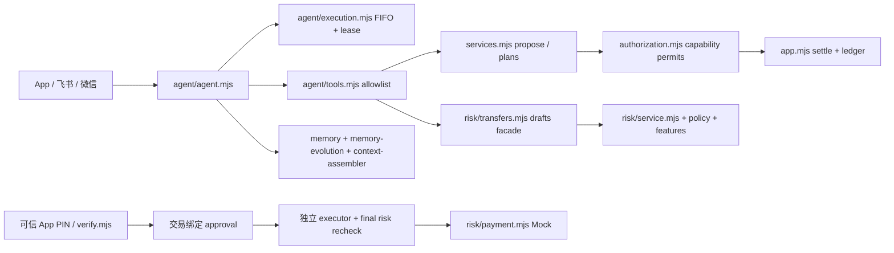

# PUMA PR0：实际仓库审查

审查日期：2026-10-30。依据 `techdocs/PUMA_Engineering_Spec.md` V1.2（用户所指 techdocx）。本报告先于业务修改编写。

## 现状与依赖

React 19 / TypeScript / Vite 前端；Express 5、Node >=24、node:sqlite 后端。单银行数据库，personalization_instance 提供内部租户标识；客户端不能选择租户。

* 调度：`server/agent/execution.mjs` 持久 FIFO/租约/工具幂等；`scheduler.mjs` 定时任务与计划。缺少跨会话用户 STOP epoch。
* 工具/提示：`agent.mjs`、`tools.mjs`、`guard.mjs`；工具白名单不含 approve/submit。对话不是支付授权。
* 认证：`app.mjs` 会话和 PIN 限流，`verify.mjs` 交易加强验证，`authorization.mjs` WeakSet capability、参数摘要、额度与执行去重。保留现有提供商。
* 交易：`risk/transfers.mjs` 有版本摘要、挑战、审批、二次风控、账户重读、唯一 provider_key；`payment.mjs` 仅 mock。旧路径 `app.mjs:prepare/settle` 同样调用固定风控。
* 记忆：`agent/memory.mjs`、`personalization-schema.mjs`、`modular-schema.mjs` 已有确认、来源、版本、过期、纠错 epoch、删除；`memory-evolution.mjs` 仅推断呈现偏好。不能替换这些机制。
* 金融数据：`db.mjs` ledger、transactions、导入的银行流水，`analytics.mjs` 分类；`risk/features.mjs` 排除内部互转/退款/未结算，MAD 回退与覆盖声明。仅有 CNY 模拟账本，无真实银行同步、可信多币种汇率、真实设备遥测或已审核 DOB 数据源。
* 风险：`risk/service.mjs` 固定规则与独立审核角色白名单；`risk/schema.mjs` 不可修改评估记录、风险标签、审核；`risk/age.mjs` 可信生日年龄计算，默认 shadow。
* 数据：`db.mjs` 幂等建表和增量 ALTER；SQLite WAL、嵌套 SAVEPOINT。新 PUMA 表采用 sidecar，不更改历史交易主键、既有表 CHECK 或 API 返回状态。
* 运维：`deploy/` Caddy/systemd 发布；`tests/` node:test；`scripts/test.mjs` 失败重跑。`.env` 含部署秘密，不读取或写入。静态加密需部署层提供，不能声称 SQLite 已加密。

## 安全控制点及基线

可信控制点为 `risk/transfers.mjs:approve/submit` 与 `authorization.mjs:assertSettlement`；仅将 drafts facade 暴露给 tools。新增控制应在这两个提交路径和工具执行边界生效，不能只依靠提示词。

原始工作区 `git status --short` 为空。默认 Node v22.19.0 不满足 engines；`npm test` 因不支持 `--test-rerun-failures` 启动失败。使用 Node 24 重跑，完整结果记录于 VALIDATION.md。PR0 仅产生报告，无业务改动。

回滚：先停止写进程并备份 SQLite（含 WAL 的一致性备份）；新增表保留以维持撤销/审计事实，关闭研究开关。不得通过回滚恢复已撤销审批、重提不确定支付或删除审计。未有真实支付渠道，撤回/冻结真实账户均为 UNSUPPORTED_BY_PROVIDER。
