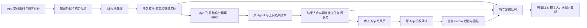

# 微信 Bot 接入实施报告

日期：2026-10-08。设计依据：工作区 `techdocs/Agentbot_unified_techdoc.md` v1.1。

## 1. 审查结论与完成边界

技术文档整体合理，已据此实现首期微信接入。后续按用户要求调整金额策略：App「消息渠道绑定」分别提供飞书、微信开关，默认关闭金额隐藏，覆盖原设计中的微信强制摘要策略。收件、Agent 执行、微信发送分离，能在慢模型期间及时反馈；业务副作用与幂等账本同事务、绑定代次和租约检查，可以防止重复消息、旧执行者和重新绑定造成重复操作；App 结果页使微信发送失败不等于业务结果丢失。

本次完成代码、数据库迁移、前端页面、自动化回归和本地浏览器验证，尚未部署。**新实现的真实手机联合验收仍未完成**，不能将自动化测试或 `sendmessage` 返回成功当作客户手机已收到。

此前真实测试的事实保持不变：扫码和收发接口走通，用户只确认看见一条余额回复，并反馈较慢。该事实支持继续接入，不足以证明手机端连续送达可靠性。

依据设计第 18 节采用以下默认值：

| 决策 | 当前实现 |
| --- | --- |
| `-14` 的含义尚未充分实测 | 标记 `reauth_required`，停止微信执行及发送，通知回 App 重新扫码；不将普通网络错误当解绑 |
| 金额展示（按用户要求更新） | 飞书、微信分别保存 `maskAmounts`，默认 false；关闭时直接显示查询结果，开启时遮盖回复与业务通知金额。App 结果不变，账号及凭据继续脱敏 |
| 平台 `client_id` 幂等语义不明 | 网络超时、无效响应及发送租约过期标记 `unknown`，不自动重发、不重跑 Agent |
| 主动推送窗口不明 | 使用最新已知 context 尝试业务通知；没有 context 等待至过期并通知 App，不承诺长期离线推送 |
| typing、延迟 ack | 暂不启用；默认立即受理提示，无这些未实现的生产配置开关 |
| 多实例容量 | 当前部署按单实例、SQLite 本地磁盘运行；租约用于失效隔离，不代表已验收多副本扩容 |

“与飞书一致”指共享 Agent、查询/分析/提议能力、权限和 App 确认流程。金额显示开关按用户及渠道分别保存；微信轮询传输和投递状态单独实现。

## 2. 已实现链路



### 扫码与身份

- 固定默认协议版本 `2.4.9`；取码使用 POST 和空 `local_token_list`，版本与鉴权头由独立协议模块统一处理。
- 登录状态归一为等待扫码、等待确认、等待验证码、成功、过期、失败、取消。支持验证码提交及 App 切回前台后恢复查询。
- QR 请求每人每分钟最多 3 次；每人只保留一个进行中的连接，全局最多 20 个；有效期 5 分钟。
- 仅本人可读、提交验证码或取消二维码；同一个微信身份不能覆盖其他用户的有效绑定，每人只允许一个活跃微信绑定。
- 成功需同时取得 `bot_token`、`ilink_user_id`、`ilink_bot_id`。新代次使用新的 `binding_session_id`；旧代次不能收件、提交工具或发送。
- 服务地址仅允许 HTTPS 的 `ilinkai.weixin.qq.com` 及其子域，禁止凭据、非默认端口和自动 HTTP 重定向。扫码跳转最多 3 次；不能取得完整凭据的 `binded_redirect` 安全失败并引导重扫。
- QR 会话只在进程内保存；服务重启后未完成二维码需重新生成。用户身份、绑定和业务任务保存在数据库。

### 接收、处理与业务

- 只接收绑定主人私聊；稳定上游消息编号按绑定代次去重，协议解析使用原始 JSON 数字文本保留 64 位编号，避免浮点精度丢失。缺编号或已经丢失精度的注入编号只记录隔离摘要，不调用 Agent。
- 收件、回复 context 快照、用户排队记录及游标推进同一事务提交。单轮回复使用该轮 context，不借用另一条请求的 context。
- 普通请求默认每用户最多 3 个待处理/运行中任务，排队最多 30 秒；全局普通执行并发 4。取消、确认链接、帮助走独立命令槽，不等待慢模型。
- App、飞书、微信以银行用户共用持久 FIFO 和执行租约。Agent 原有工具轮数、超时、权限、沙箱和资金规则继续生效。
- 提议、计划、订阅授权查询、记忆、提醒和人工工单经过 `agent_tool_effects`。同一 request/tool 复用已提交结果，参数冲突拒绝；业务写入及 committed 状态同事务，prepared/failed 不自动重放。
- 工具提交前检查绑定代次、会话、授权、账户和执行租约。模型返回后若已解绑或租约失效，不得提交新副作用及最终结果。
- Agent 结果、运行记录、对话历史、inbox 终态和 final/error 发送任务同事务保存；微信发不出去不回滚业务、不重跑模型。
- 微信命令“确认”仅返回 App 入口；真正确认仍需 App 支付密码及适用的加强验证。取消仅限当前用户和绑定会话内操作。

## 3. “舒缓焦虑”提示

| 时机 | 当前文案/行为 |
| --- | --- |
| 普通请求持久化后 | “已收到，正在处理，请稍等。” |
| 前一条仍在处理 | “已收到，上一条请求还在处理，这条会接着处理，请稍等。” |
| 等待/执行约 8 秒 | 最多再发一次“还在处理这条请求，请稍等，不用重复发送。”或排队提示 |
| 查询或处理完成 | 直接发送结果；按微信金额开关决定是否遮盖金额，超长内容附 App 完整结果链接 |
| 提议完成 | 明确“尚未执行”，给出编号、App 确认链接与取消方式；发送前复核操作最新状态 |
| 处理失败/超时/重启中断 | 明确未完成或中断，并提供查看已生成操作和结果的 App 入口 |
| 微信发送未知、失败或过期 | App 消息中心提醒“微信回复送达未确认”，本人请求结果仍可查看 |

提示是独立任务，不等待模型；模型也不等待提示网络完成。ack 3 秒、progress 5 秒过期，提示发送网络等待上限为 2 秒；final 就绪后取消尚未发送的提示，并优先调度 final。每绑定最多一条在途发送，避免本服务并发发送同一绑定的提示与结果。

平台可能发生重排或漏收，因此上述顺序是本服务的调度保证，不能视为手机显示顺序保证。没有可信送达或已读回执，不显示“你已收到”；接口成功使用 `api_accepted`，前端说明“此状态不代表手机已收到”。目前没有写入用户确认送达的 API，预留字段不冒充已实现回执。

## 4. 可靠发送与恢复

| 状态/场景 | 行为 |
| --- | --- |
| 明确成功 | `api_accepted`；保存响应类别、HTTP 状态和可用的服务端消息编号 |
| 缺少业务返回码但 HTTP/JSON 有效 | `legacy_missing_code`，仅记录接口响应证据 |
| 明确 HTTP 429 | final/业务通知退避重试，尊重 Retry-After，正文不变时复用同一 client_id，最多 6 次；设置或状态变更导致正文改变时使用新编号；过程提示不重试 |
| 超时、网络中断、5xx、无效响应 | `unknown`，立即提示 App，默认 5 分钟后标记人工核查，不自动重发 |
| 发送中 Worker 失效 | 租约到期转 unknown；旧响应不能再标记接受，需核查 |
| 重启前 final 已持久化、未发送 | 仅继续发送，不重跑 Agent |
| 重启前 Agent 执行未完成 | 租约到期转 interrupted；已提交业务和账本保留，指向 App 核对 |
| 解绑/重绑 | 中止旧任务；旧代次未发任务取消，在途任务保守记 unknown；新代次不能复活旧任务 |

原有 `channel_outbox` 的微信记录经唯一 `source_outbox_id` 桥接，原行标记 forwarded，防止新旧发送器重复发送。业务通知发送结果正文与 App 入口，同样遵循该用户的微信金额开关。一个结果含超过 3 项操作时改为结果页摘要，避免长文本刷屏。

## 5. 文件与数据

| 文件 | 职责 |
| --- | --- |
| `server/channels/wechat.mjs` | QR 生命周期、绑定、长轮询、重新认证、控制开关和清理 |
| `server/channels/wechat-protocol.mjs` | 版本、请求头、主机白名单、响应分级 |
| `server/channels/wechat-inbox.mjs` | 收件、命令、调度、等待提示、原子完成和本人结果接口 |
| `server/channels/wechat-delivery.mjs` | 持久发送、租约、重试、未知状态、App 兜底、outbox 桥接 |
| `server/channels/wechat-state.mjs` | 绑定/租约校验、安全结果模板 |
| `server/channels/wechat-schema.mjs` | 增量迁移、索引、安全事件触发器 |
| `server/agent/execution.mjs` | 跨渠道 FIFO、用户租约、工具副作用幂等 |
| `src/pages/WeChatChannel.tsx` | 微信扫码、验证码、绑定状态及最近请求 |
| `src/pages/ChannelRequest.tsx` | 本人完整结果、最新操作卡片、真实投递状态 |
| `tests/wechat-*.test.mjs` | 协议、业务链路、反馈、故障隔离、重启和性能回归 |
| `scripts/check-wechat-ui.mjs` | 可重复运行的手机尺寸浏览器验收 |

新增渠道偏好表 `channel_preferences` 以 `(user_id,channel)` 为主键，保存布尔金额开关；解绑不删除偏好，其他用户无法更改。

新增表：`wechat_inbox`、`wechat_deliveries`、`wechat_quarantine`、`agent_execution_queue`、`user_execution_leases`、`agent_tool_effects`。`channel_bindings` 扩展绑定代次、会话、授权状态、健康时间和轮询租约。

迁移不删除银行历史数据。发现历史多微信活跃绑定冲突时不强行删除或创建唯一索引，拒绝新的扫码绑定，需先核对存量。密码/支付密码修改使微信需要重新认证；借记账户冻结等非活跃状态使微信暂停，恢复账户不会静默恢复旧渠道授权。

原始入站正文与 context 终态后 24 小时清理；发送密文及 context 在创建超过 24 小时且进入终态后清理，未完成/可重试任务不清理。隔离摘要保留 7 天。首期长期保留去重键、结果记录和工具效果引用，不假设微信只重投 7 天；这些记录及既有银行审计的容量/归档由运维单独管理。

## 6. 配置与启动

运行环境为 Node.js 24+。复制 `.env.example` 时保留已有密钥，禁止每次重启重新生成 `CHANNEL_SECRET`，否则已绑定凭据无法解密。

```dotenv
WECHAT_ENABLED=true
CHANNEL_SECRET=<现有64位十六进制密钥>
PUBLIC_ORIGIN=https://你的银行域名
WECHAT_ACCEPT_NEW_MESSAGES=true
WECHAT_FEEDBACK_ENABLED=true
WECHAT_PROGRESS_AFTER_MS=8000
WECHAT_SEND_TIMEOUT_MS=8000
WECHAT_MAX_PENDING_PER_USER=3
WECHAT_SEND_CONCURRENCY=4
WECHAT_PROTOCOL_VERSION=2.4.9
WECHAT_UNKNOWN_REVIEW_AFTER_MS=300000
```

聊天模型继续使用 `CHAT_API_KEY/CHAT_BASE_URL/CHAT_MODEL`。微信连接不需要公网入站 webhook，手机打开 App 结果及确认入口需要可访问的 `PUBLIC_ORIGIN`。

数值配置启动时验证：进度阈值 500～60000ms，普通发送超时 500～12000ms，用户待处理上限 1～10，发送并发 1～8，unknown 核查阈值 1000～86400000ms。生产轮询及执行租约固定 60 秒，发送租约 15 秒，执行约每 20 秒续租；测试可通过构造选项注入较短租约。没有启用设计中尚属实验的 ACK_COALESCE、TYPING 或统一 LEASE 环境变量。

```sh
npm test
npm run build
npm start
```

浏览器验收先构建，再安装可用的 Playwright 或设置 `PLAYWRIGHT_PACKAGE` 为其 package.json 绝对路径，运行 `node scripts/check-wechat-ui.mjs`；Windows 可设 `BROWSER_CHANNEL=msedge`。脚本只用隔离演示数据库和假微信/模型，截图写入被忽略的 `test-results/`。

API 契约已更新到 [API 说明](API.md)，设置接口为 `GET /api/channels/preferences` 和 `PATCH /api/channels/preferences/{channel}`；旧 `CHANNEL_MASK_AMOUNTS` 环境变量不再控制显示。请求完整结果入口为 `/#wechat-requests/{id}`。`GET /api/channels/wechat/requests/{id}` 对其他用户返回 404；不返回 token、QR 凭据或 context。

## 7. 验证记录与剩余准入

金额开关调整后：完整自动化回归 **102 项通过**，前端构建通过；手机尺寸浏览器已验证两个开关互不影响、刷新后恢复、保存失败保持原状态，并复测扫码绑定和结果页。新增测试覆盖用户隔离、解绑/重启保留、两个渠道真实发送路径的金额处理、待发任务及明确限流后的设置变更。旧环境金额开关不再覆盖用户选择。

2026-10-08 本地验证：

- 完整自动化回归 **98 项通过**，包含原 Agent、银行权限/资金、飞书共享与专属机器人及微信新增测试。
- 最后对消息编号精度及 unknown 核查阈值修订后，微信与飞书相关 **23 项复测通过**。
- `npm run build` 通过；Vite 提示主包超过 500kB，为体积提示，不影响本次构建。
- 430px 浏览器完成二维码展示、验证码、绑定、unknown 结果页、未登录深链接、登录返回原结果、解绑；无页面异常或横向溢出，并已查看截图。
- 受控上游 20 轮测试：一轮完整回归中首次发送调用 p95 **41ms**，final 就绪到发送调用 p95 **25ms**，均小于设计 1 秒门槛。样本是本地假网络，不能用于宣传微信手机送达率或真实网络时延。
- SQLite 在线备份后重新打开验证：已完成任务只恢复发送、执行中任务中断而不重跑、已提交工具效果复用。
- 故障测试包含响应未知、明确限流、迟到发送响应、模型等待期间解绑、旧代次入站、缺 context、跨用户查询、跨渠道排队、普通槽满时取消，以及功能关闭/只排空。

仍需按原设计第 14.2 节完成真实联合验收：本人扫码及可选验证码；测试/余额/账单与 12 秒慢处理提示；确认与取消；20 轮带编号请求逐条在手机核对；两位演示用户与可用的 iOS/Android 环境；空闲 30 分钟、数小时、隔日的主动通知边界。真实验证码、重定向和 `-14` 的平台含义也需记录实际观测。

这些是开放真实用户前的外部验证门槛。本地测试没有修复或证明此前平台少收消息的原因；当前实现使每轮请求和投递可以区分、追踪、恢复并在 App 兜底。

## 8. 运维与回滚

先做 SQLite 在线备份，再启动新版本自动迁移。保持单实例，不复制运行中的单个 `.sqlite` 文件而忽略 WAL。保留 `CHANNEL_SECRET` 和数据库。

停止新增但排空：保持 `WECHAT_ENABLED=true`，设置 `WECHAT_ACCEPT_NEW_MESSAGES=false` 后重启。停止全部微信 worker：`WECHAT_ENABLED=false` 后重启，已接收任务及状态仍保留；重开时未完成执行按租约转中断，不重跑业务。

检查结果、投递和执行账本后才能回退到兼容版本。禁止直接启动旧同步 `pollOnce` 绕过新 inbox 去重，不删除新表或幂等记录来回滚。飞书与银行页面仍按原启动方式运行。

以下为本地管理数据库的只读排查例子，不新增公开全局管理接口：

```sql
SELECT auth_state,connection_state,count(*) AS bindings
FROM channel_bindings WHERE channel='wechat' AND status='active'
GROUP BY auth_state,connection_state;

SELECT status,count(*) AS requests,min(received_at) AS oldest_received_at
FROM wechat_inbox GROUP BY status;

SELECT kind,status,count(*) AS deliveries,sum(needs_review) AS review
FROM wechat_deliveries GROUP BY kind,status;

SELECT request_id,tool_call_id,effect_type,status,effect_ref,safe_error_code
FROM agent_tool_effects WHERE status<>'committed';
```

用 `request_id → run_id → tool effect/action → delivery.client_id` 关联诊断。inbox 的 received/started/finished 和 delivery 的 created/started/api_accepted 时间区分收件、排队、处理及发送；接口接受后仍缺少手机可见时间。独立监控系统的告警阈值、WAL 磁盘告警和长期归档尚需按部署环境配置，本次未宣称提供新的全局运维面板。

协议来源固定为腾讯插件提交 [24de5c9](https://github.com/Tencent/openclaw-weixin/tree/24de5c9eb0dd5e595d7e2d090ed8a3f82870d42c)。协议升级需重新核对并联调，不只修改版本号。
